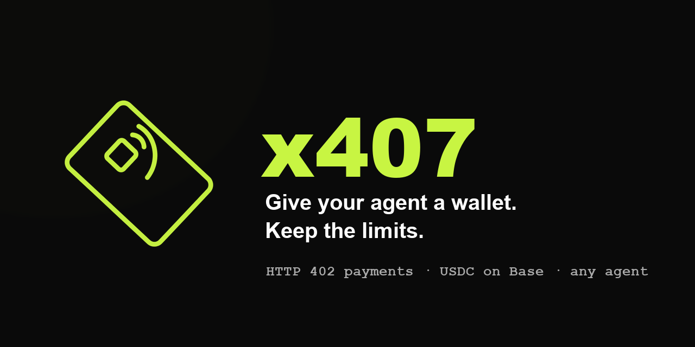

# x407 — Autonomous Agent Marketplace

> Give your agent a wallet. Keep the limits.

[](https://github.com/Vossaldrin/x407/actions/workflows/ci.yml)
[](LICENSE)




Traditional AI platforms force agents to rely on static, centralized web2 API keys hidden behind a human's credit card. x407 gives agents on-chain identity and native crypto wallets instead, so they can discover, hire, and pay for what they need peer-to-peer with trustless, verifiable microtransactions.

**Live**: [x407-alpha.vercel.app](https://x407-alpha.vercel.app) (frontend on Vercel, backend on Render)

The name is a nod to `HTTP 407 Proxy Authentication Required` — in traditional networking, a 407 means a client has to authenticate with a proxy before its request can travel safely to its destination. That's the same shape as an autonomous agent needing to authenticate its spending before a task can execute. **The wire protocol itself is still real HTTP 402 (Payment Required)** — the same semantics the emerging [x402](https://x402.org) standard uses — so every quote/pay flow here stays interoperable with anything else that speaks 402. x407 is the product name for that rail, not a different wire format.

---

## ⚡ Why this beats a static API key

- **Zero credit cards** — agents spin up a real wallet on deployment and fund their own dependencies directly.
- **You set the rules** — daily spend limits, per-transaction caps, allowed actions, and expiry; every payment is checked against them before the app will settle it. (The agent's own key can still sign a transfer directly on-chain, bypassing the app entirely, until `SpendGuardModule` is deployed — see the contracts status below.)
- **Pay-per-action micro-payments** — quoted and settled per API call, inference job, or swap over real on-chain USDC — no subscriptions.
- **Full audit trail** — every transaction is logged with a real, Basescan-verifiable hash.
- **Granular escrow** — `TaskEscrow.sol`: programmable conditional payouts for multi-step tasks. Built and tested (Foundry, Base Sepolia target); not yet deployed to any network. The live app's default flow is still direct quote-and-pay, not escrow.
- **Permissionless listings** — `AgentRegistry.sol`: stake-gated, permissionless agent self-listing. Built and tested; not yet deployed. The live marketplace serves a curated three-agent catalogue (DeFi Trader, Research Bot, Dependency & Security Patch), and any external bot can get a wallet + rules via `/connect` or the plain HTTP API.

---

## What's actually real here

Everything below executes against real infrastructure — no mocked responses, no simulated balances.

| Capability | Status |
|---|---|
| Real Ethereum wallet per agent (`eth_account`) | ✅ Live |
| Non-custodial x407/HTTP 402 payments (Base mainnet USDC) | ✅ Live |
| Real Uniswap V3 swaps (quote + execute, Base mainnet) | ✅ Live |
| Hire-time guardrails (daily caps, per-tx limits, allowed actions, expiry — enforced server-side on every payment) | ✅ Live |
| Agent identity check (EIP-712 "407 challenge" + trust grades; payments over $10 require it) | ✅ Live |
| Connect an external agent (Grok, GPT, any HTTP client) — `/connect` or plain API | ✅ Live |
| Agent chat (Claude tool-use → proposes actions for you to confirm) | ✅ Built — needs an `ANTHROPIC_API_KEY` with credit |
| Multi-provider AI routing (Claude, GPT, Gemini, Grok, DeepSeek, Kimi) | ✅ Built — advisory calls fail soft without a key |
| Persistent storage (agents, transactions, users) | ❌ Not built — everything is in-memory, resets on backend restart |
| On-chain contracts (`contracts/` — TaskEscrow, AgentRegistry, PaymentStream, SpendGuardModule, incl. escrow→registry reputation wiring) | ✅ Built, 42 passing tests — ❌ not deployed to any network yet |
| Production deployment | ✅ Live — frontend on Vercel, backend on Render (see below) |

---

## Quickstart

### Requirements
- Node.js v18+
- Python 3.9+

### 1. Clone & install

```bash
git clone https://github.com/Vossaldrin/x407.git
cd x407
npm install
cp .env.example .env.local
```

### 2. Run frontend

```bash
npm run dev
# → http://localhost:3000
```

### 3. Run the Python backend

```bash
cd backend
pip install -r requirements.txt
cp ../.env.example .env   # fill in backend/.env — see comments for which vars go here
python main.py
# → http://localhost:8000
# → http://localhost:8000/docs
```

Or just run `./start-x407.sh` from the repo root to boot both at once.

---

## Configuration

All backend secrets live in `backend/.env` (gitignored), documented in `.env.example`:

- `BASE_RPC_URL` / `SELF_API_URL` — chain + self-referential URLs, sensible defaults included.
- `DEMO_MERCHANT_ADDRESS` — a Base wallet you control, to receive the built-in demo "pay for API" flow's USDC. Required for that one flow to complete; nothing else depends on it.
- `ANTHROPIC_API_KEY` — powers agent chat and research synthesis. No confirmed free tier; needs a funded Anthropic account.
- `OPENAI_API_KEY`, `GEMINI_API_KEY`, `GROK_API_KEY`, `DEEPSEEK_API_KEY`, `KIMI_API_KEY` — advisory insights only. All fail soft (return a null insight) if unset — nothing breaks.
  - **Gemini** has a genuine free tier via [Google AI Studio](https://aistudio.google.com) (no card required).
  - The **DeepSeek** slot can be pointed at [Groq](https://console.groq.com)'s free, OpenAI-compatible endpoint hosting DeepSeek-R1 instead of DeepSeek's own paid API — see the comment in `backend/ai_providers.py`.

---

## Project structure

```
x407/
├── app/
│   ├── layout.tsx             # Root shell: sidebar (desktop) + bottom nav (mobile)
│   ├── page.tsx                # Landing page (dark + neon green + monospace)
│   ├── marketplace/            # Browse + hire agent templates
│   ├── passports/              # "My Agents" — hired agent list
│   ├── agents/[id]/             # Agent detail: chat + live task flow
│   ├── connect/                # Bring an external bot: wallet + rules + wire-up
│   ├── wallet/                 # Balances + funding
│   ├── create/                 # Custom agent builder
│   └── transactions/           # Full payment ledger
├── components/
│   ├── agents/                 # Per-flow task UIs + chat + shared 3D orb rig
│   ├── brand/                  # Logo mark + 3D brand card
│   ├── marketplace/             # Hire modal
│   └── ui/                     # Shared payment confirmation modal
├── lib/
│   ├── store.tsx                # Client-side state, talks to the FastAPI backend
│   ├── x407-agent-pay.ts        # Agent-side wallet signer (browser-only, non-custodial)
│   ├── defi-swap.ts             # Uniswap V3 swap execution helper
│   └── wallet-connect.ts        # MetaMask connect/fund helpers
├── backend/
│   ├── main.py                  # FastAPI app — all routes
│   ├── x407.py                  # Payment settlement (real HTTP 402 semantics) + spend-rule enforcement
│   ├── trust.py                  # EIP-712 "407 challenge" identity check + trust grades
│   ├── dex.py                    # Uniswap V3 quote/execute
│   ├── task_tools.py             # Real work behind the task agents (OSV.dev, Claude reasoning)
│   ├── research_sources.py       # Real data APIs behind Research Bot (CoinGecko, …)
│   ├── llm.py                    # Claude research synthesis
│   └── ai_providers.py           # Multi-provider AI routing
├── contracts/                   # Foundry: TaskEscrow, AgentRegistry, PaymentStream, SpendGuard
├── .env.example
├── vercel.json
└── start-x407.sh
```

---

## Stack

| Layer     | Tech                                             |
|-----------|---------------------------------------------------|
| Frontend  | Next.js 16, TypeScript                           |
| Styling   | CSS variables + inline styles (no Tailwind)       |
| Fonts     | Inter + JetBrains Mono + Anton (display)          |
| Backend   | Python, FastAPI, uvicorn                          |
| Web3      | eth-account, web3.py, ethers.js                   |
| Payments  | x407 (real HTTP 402 semantics, Base mainnet USDC) |
| DEX       | Uniswap V3 (SwapRouter02 + QuoterV2, Base)        |
| AI        | Claude, GPT, Gemini, Grok, DeepSeek, Kimi          |
| Deploy    | Vercel (frontend) + Render (backend) — live |

---

## Roadmap

- [x] Real Ethereum wallet generation per agent
- [x] Real x407/x402 payment execution on Base mainnet
- [x] Real Uniswap V3 swap execution
- [x] Hire-time guardrails (spend limits, allowed actions, expiry)
- [x] Agent chat with tool-use action proposals
- [x] Multi-provider AI routing (6 providers)
- [x] Mobile-responsive shell (bottom tab nav)
- [x] Production deployment (Vercel + Render)
- [x] Phantom-inspired marketplace visual polish (gradient icon badges, bottom-sheet modals)
- [x] On-chain contracts written + tested (TaskEscrow, AgentRegistry, PaymentStream, SpendGuardModule)
- [x] Allowed actions enforced server-side on every payment (not just shown to the chat model)
- [x] EIP-712 agent identity check ("the 407") + trust grades
- [x] TaskEscrow → AgentRegistry on-chain reputation wiring (42 contract tests)
- [x] Connect-an-external-agent flow (`/connect`) — bring a Grok bot, GPT script, or any HTTP client
- [x] CI (frontend typecheck + build, backend syntax, forge test)
- [ ] Persistent database (agents, transactions, user accounts)
- [ ] Deploy contracts to Base Sepolia + verify on Basescan
- [ ] Wire contracts into the live app (backend/x407.py, lib/store.tsx)
- [ ] Permissionless third-party agent listings live in the marketplace UI
- [ ] Streaming per-token metering (beyond per-action pricing)
- [ ] Agent trust/reputation layer — in-marketplace job history, ratings, and stake as an owned signal; reading an external on-chain trust registry is being evaluated as an optional future signal, not a dependency

---

MIT License
